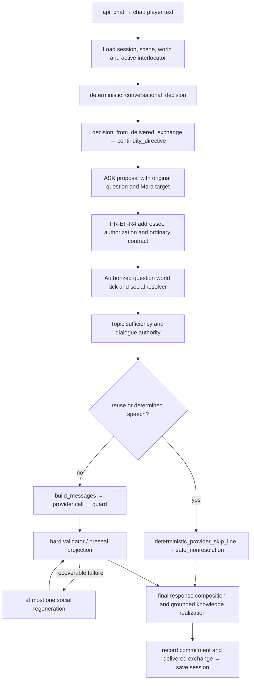

# 03 — Production Dialogue Pipeline

The exact question is “Why do you prefer the evening?” after delivered “I prefer the evening.” `exact_preference_trace.json` retains the direct production function response, resolution, authority and saved disposable session; model calls were disabled and narration was instrumented to fail if invoked. This is a local executed production trace, not a fresh provider transcript.

| Step | Actual source / behavior |
| --- | --- |
| 1 incoming | `game/api.py:6298` HTTP wrapper, `:6306` chat; original question retained |
| 2 target | chat loads storage, snapshots interlocutor; `ordinary_semantic_ownership.py:643` assess_addressee_grounding is the shared authorization owner |
| 3 history | `conversational_continuity.py:228` delivered_exchanges; bounded eight rows, not raw rejected candidates |
| 4 authorization | `conversational_orchestration.py:2014`, `:235`; directive yields ASK for present Mara; `ordinary_semantic_ownership.py:538`, `:143` preserve authorization/contract |
| 5 resolution | `api.py:6641` existing tick occurs after executable authorization; `social.py:3848` resolve_social_action |
| 6 knowledge | `social.py:1564`, `:1587`, `:1611`, `:4219` select sufficient authored topic, not any matching noun; no authored cause for evening |
| 7 speech authority | `dialogue_authority.py:206`, `:304`; opinion/belief normally incidental, then `conversational_continuity.py:459` finds preference commitment |
| 8 deterministic selection | authority sets exact stored `player_line`, `reuse_prior_speech=true`, `narration_determined=true`, incidental false and speech authority none |
| 9 eligibility | `ordinary_semantic_ownership.py:871`, `api.py:1002`; skip reason determined_nonresolution |
| 10 assembly | bypassed for this trace. General path `api.py:3304` → `gm.py:4567` build_messages → `prompt_context.py:1527`; retained payloads in production_captures_offline.json |
| 11 output | no provider narration in exact trace. Eligible lane calls `gm.py:5055` call_gpt; configured Responses route, cap and usage accounting |
| 12 validation | `response_policy_enforcement.py:905` guard; `immutable_valid_response.py:584` direct validator and `:1383` preseal lifecycle, plus final gate |
| 13 retry | `api.py:3794` enables one regeneration except determined speech; retry resends original messages plus feedback. `gm_retry.py:681`, `:1249` older retry guidance/checks |
| 14 delivered | seeded trace ultimately says “Sergeant Mara shakes their head. ‘I don't know.’” with grounded_social_absence_realization, despite retained preference authority |
| 15 retention | `api.py:5951` remember_dialogue_commitment, `:5960` record_delivered_exchange; early-return bookkeeping at `:797`, `:817` |
| 16 mutation | trace turn 0→1 and world tick changed disposable world; this is pre-existing ASK advancement. `api.py:2435` resolution update adoption, `:5975` session persistence. Speech recorder does not create world facts |

Selection/replacement points: direct GM recall/corrections can return before resolver; clarification/repeat helpers quote speech; authority reuses commitment; API skips narration; authored knowledge preseal projection can replace paraphrase; absence projection can replace harmless speech; invalid responses can become safe nonresolution; final knowledge realization can overwrite stored preference reuse. See `immutable_valid_response.py:1087`, `social.py:2497`, `:3044`, `:3109`, `:3167`.

Question-loss risks: lexical repeat/meaning matching conflates paraphrase and explanation; commitment reuse answers “why” with “what”; raw question survives structurally but its requested operation can be discarded by reuse. Context-loss risks: eight-exchange eviction, subject token matching, 180-character commitment truncation and duplicated prompt projections with conflicting postures. Expensive-call risks: an eligible first answer still assembles the full policy/contract payload; retries resend it. Unsupported consequential information may survive weak lexical validation even without any structured mutation. Noncanonical speech may still affect player decisions and become retained as a commitment.

The separate offline three-turn capture uses scripted interpretation to force comparable prompt construction; it is not the same route as the no-provider exact trace. Both are labeled and retained. No finding is repaired in this cycle.

Evidence labels: **FRESH** = actual isolated provider response; **LOCAL** = executed production helper with disposable fixtures; **STATIC** = source inspection; **HISTORICAL** = retained PR-EG-R1/earlier evidence; **INFERENCE** = assessment beyond the measured sample. No isolated result is full production qualification.
