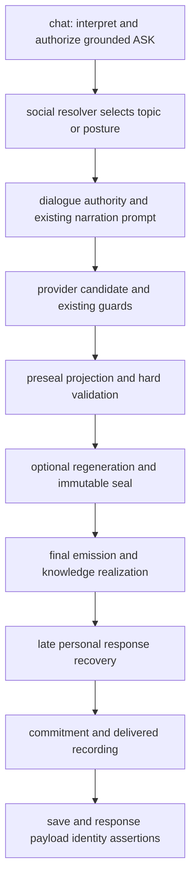

# 16 — Final Response Integrity

STATIC current path:

Current locations: ordinary_semantic_ownership.py assess_addressee_grounding and conversational_authorization_record; social.py:1611 topic selection, :4219 onward resolution/revelation, :4275 attach authority; dialogue_authority.py:206/304 construction/attachment; immutable_valid_response.py:584 validator, :1087 projection, :1240 seal, :1383 lifecycle; api.py:3794 retry, :4198 preservation, :5941 late personal recovery, :5951/5960 recorders, :5975 save, :6037 final payload identity assertion. Source snapshots retain the actual current code.

_project_authorized_social_answer_before_seal may replace a faithful road paraphrase when lexical communication recognition fails. Without topic evidence, social-invention scans can force absence/refusal. Sealed responses bypass several downstream repairs, but an immutable seal proves only the existing validator’s decision, not semantic authority. Late personal recovery can replace text before recording. The final payload assertion compares canonical/payload wording, not candidate/evidence authority.

LOCAL exact unsafe claim is preserved; other personal wording becomes a route-refusal. Rejected words in G/H/I never enter delivered history because generation is skipped; that does not demonstrate rejecting a supplied candidate after evaluation. J’s paraphrase is replaced by authored answer; a contradictory fallback was not forcibly injected because no contract-aware seam exists. A future replacement needs its own authority and final identity binding; do not bypass current safety projection to preserve prose.

Evidence classes: STATIC = current source inspection; LOCAL = executed current production functions with disposable fixtures and external wire doubles; FRESH = new provider request; HISTORICAL = retained predecessor evidence; REPLAY = recombination of measured results; INFERENCE = proposed design; UNVERIFIED = not exercised. No fresh full-production API test was performed.
