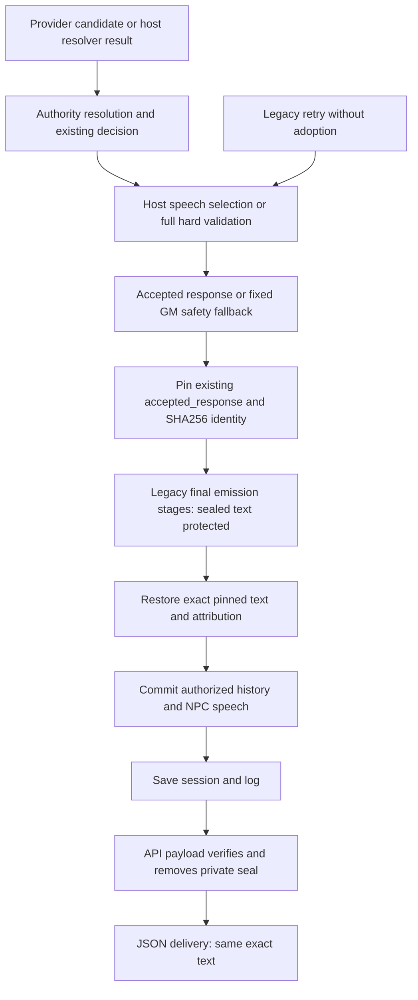

# 04 — Response-Path Audit

Real ordering differs from the ideal: host adoption occurs before the legacy final emission gate; post-gate reconciliation and preservation historically ran afterward. Both resolved chat and structured action share finalization. Conversational decisions seal their host response separately using the same record. Missing-adoption social retries now enter complete authorization before legacy stages; other legacy finalizations enter the same validator before history. Pipeline-origin state mutation is resolver owned and precedes narration; final delivery adds no mutation authority. See source diffs and inventory.
