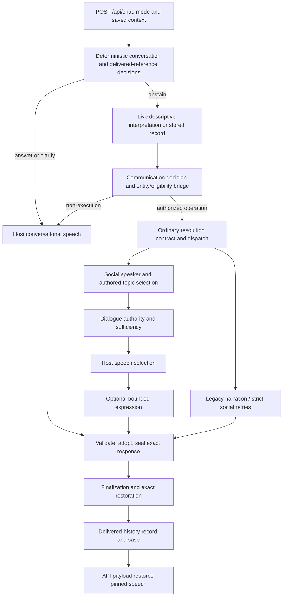

# 03 — Source Level Pipeline Map

PR-EG-R5 · 2026-10-17 · investigation only

The diagram shows alternate paths, not 18 mandatory calls on every turn. Raw text remains available downstream; loss here means a decision stops using its meaning, not physical deletion of the input.

| Stage / source | Inputs → outputs | Authority | Provider | State dependencies | Fallback | Prior-decision override |
|---|---|---|---|---|---|---|
| Entry and mode: [game/api.py:6353](../../game/api.py#L6353) | HTTP text, mode, saved state → turn inputs | Host | No | session/log/scene | bad mode or pending-state response | can choose OOC/nonmutating path |
| Deterministic conversation: [game/conversational_orchestration.py:2024](../../game/conversational_orchestration.py#L2024) | utterance + context → decision or abstain | Host semantic heuristics | No | pending intent, scene, delivered speech | clarify/answer/decline | can terminate before provider |
| Delivered reference: [game/conversational_continuity.py:582](../../game/conversational_continuity.py#L582) | utterance + delivered rows → owner/speaker/line | Host semantic heuristics | No | delivered_exchanges, active NPC | repeat, ambiguity, absent-speaker line | can override interpretation and topic |
| Live interpretation: [game/live_chat_interpretation.py:297](../../game/live_chat_interpretation.py#L297) | visible catalog + 2 clipped turns → descriptive record | Provider proposal; host schema gate | One call if reached | public evidence, pending summary | blocked/skipped; no guessed execution | proposal not executable authority |
| Compatibility adaptation: [game/player_interpretation_bridge.py:196](../../game/player_interpretation_bridge.py#L196) | record + raw text → normalized action/rejection | Host eligibility | No | roster, references, scene | focused clarification | can reject proposed target/operation |
| Communication planning: [game/conversational_orchestration.py:2168](../../game/conversational_orchestration.py#L2168) | record → ANSWER/CLARIFY/EXECUTE/etc. | Host semantic policy | No | pending, delivered references | MIXED becomes clarification | can reclassify provider owner |
| Grounding and selection: [game/ordinary_semantic_ownership.py:643](../../game/ordinary_semantic_ownership.py#L643) | text + proposed target → grounded authority | Host | No | referent catalog, discourse focus | ambiguous/unsupported target | rechecks target independently |
| Legacy interpretation: [game/intent_parser.py:1](../../game/intent_parser.py#L1) | raw input → ordinary action shape | Host | Optional legacy proposal path | interaction routing and scene | unparsed/recovery | reachable when newer paths abstain |
| Resolver dispatch: [game/ordinary_semantic_ownership.py:331](../../game/ordinary_semantic_ownership.py#L331) | resolution contract → specialized family | Host | No | commitment and operation | generation/adjudication | selects execution owner |
| NPC knowledge: [game/social.py:1611](../../game/social.py#L1611) | question + NPC topics → selected topic or none | Host disclosure and lexical relevance | No | revealed topics, pressure, NPC runtime | uncertainty/clarification/recalled topic | can select different subject evidence |
| Authority and sufficiency: [game/dialogue_authority.py:286](../../game/dialogue_authority.py#L286) | topic + question → posture/scope/line | Host | No | commitments, delivered source | partial/unknown/belief | may select prior or deterministic personal line |
| Host speech choice: [game/dialogue_authority.py:495](../../game/dialogue_authority.py#L495) | authorized social plan → base speech | Host | No | selected fact and posture | bounded personal/uncertainty/refusal | may supersede initial generated candidate |
| Expression: [game/expressive_dialogue.py:910](../../game/expressive_dialogue.py#L910) | base speech + semantic scope → candidate | Provider wording proposal | At most one expression attempt | proposition identity/aliases | host line retained on rejection | cannot independently authorize facts |
| Legacy narration/retry: [game/gm.py:5055](../../game/gm.py#L5055) | provider context → GM candidate | Provider proposal | strict_social and escalation possible | prompt_context, social plan, policy | gm_retry terminal fallback | candidate only before final adoption |
| Validate and adopt: [game/immutable_valid_response.py:1491](../../game/immutable_valid_response.py#L1491) | candidate + resolver authorities → adopted speech | Host | regeneration only eligible paths | contract, referents, world facts | fixed GM safe_nonresolution | final semantic choice and seal |
| Finalization: [game/api_turn_support.py:601](../../game/api_turn_support.py#L601) | adopted GM output → final output | Host integrity | No new delivery call | seal and state consistency | missing adoption reauthorization | sealed text restored; legacy mutators denied |
| Record and persist: [game/conversational_continuity.py:171](../../game/conversational_continuity.py#L171) | exact adoption → delivered history | Host persistence | No | conversational_context and commitments | reject divergent delivery | no rejected candidate promoted |
| Serialize: [game/api_turn_support.py:1382](../../game/api_turn_support.py#L1382) | sealed output + state → JSON payload | Host | No | pinned adoption and public record | integrity mismatch fails closed | restores exact text before stripping internals |

`/api/action` shares final adoption/finalization and records authorized delivery; it bypasses free-text conversational interpretation. Other relevant enforcement modules are inventoried in report 27, including final-emission, speaker, narration consistency and response-policy stages.
