# 21 — Recommended Target Architecture

PR-EG-R5 · 2026-10-17 · investigation only

Choose C with one consolidated conversational decision owner. Preserve raw utterance and source spans through the following boundaries:

```mermaid
flowchart LR
  A[Utterance + bounded delivered events + visible roster] --> B[One semantic plan proposal]
  B --> C[Host entity grounding and modality gate]
  C --> D[Host-permitted source candidates]
  D --> E[Relevance and coverage in the bounded plan]
  E --> F[Host authorization binds exact propositions]
  F --> G[Scoped wording or deterministic fallback]
  G --> H[Existing final validate / adopt / seal]
  H --> I[Existing delivered history + persistence + exact API]
```

The diagram expresses responsibilities, not a requirement for multiple provider calls. Supply the already permitted candidate set in the initial compact semantic call when feasible. If retrieval cannot fit, defer to a separately budgeted next interaction rather than inventing an answer. Do not send hidden candidates for the AI to decide permission.

Plan fields: communication recipient; addressee IDs and supporting spans; referenced-person IDs; act; subject/relation; correction_of event/interpretation and replacement subject; requested/covered/unanswered slots; permitted source IDs; epistemic status; answer/partial/uncertainty/acknowledge/clarify plan; proposed action components with commitment modality. No state updates, rewards, NPC commitments or new consequential facts are executable model fields. Every field remains a proposal.

Host validates catalog/presence, immutable history references, player commitment and actual source ownership/disclosure, then emits a single authorized plan. It may reject a field with a typed reason, but does not silently select a different semantic subject. Existing mechanics resolvers alone authorize actions, time, resources and consequential commitments. Source truth, NPC belief, rumor and generated incidental speech stay explicitly distinct; “NPC said” never upgrades to canonical truth.

Use existing delivered_exchanges as the speech-event basis, retaining proposition identity, speaker, source, epistemic status and correction linkage. Derive focus/commitment indexes; no independent memory ledger. Save the existing session state and bound delivery atomically through the current persistence workflow; prove reload yields the same references before rollout.

Final wording uses exact authorized sources for factual speech and bounded first-person acknowledgment/characterization for incidental speech. Both pass existing final adoption. Reject unsupported implications; one fixed context-aware host fallback must also be validated and sealed. Downstream text restoration, exact history and API equality remain mandatory. Keep rejection diagnostics separate from adopted speech.

Expected effects: relation coverage prevents bell-for-manager; typed ambiguity preserves named speakers; correction linkage prevents replay of rejected topics; shared proposition binding prevents morning/evening drift; explicit acknowledgment supports recovery; speech acts avoid consequential-action validation when no action is proposed. These are design predictions, not demonstrated production gains. Performance target is one compact semantic call, optionally one bounded expression call, with no strict-social escalation in the migrated slice. Actual budgets and latency must be measured against the next protocol.
